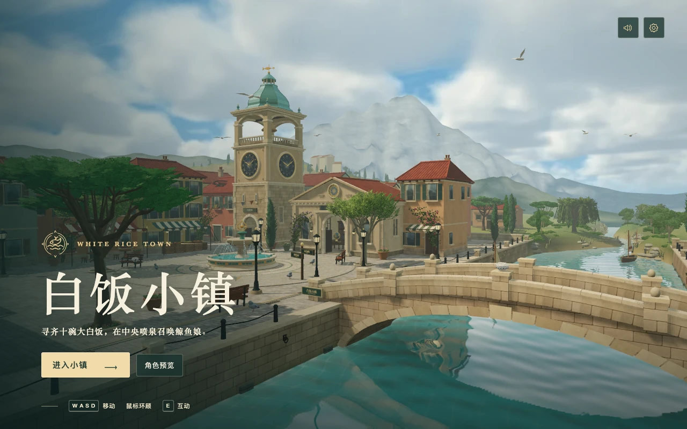

# 白饭小镇 · White Rice Town

一个可以双击打开的第一人称河畔小镇。沿石拱桥去东岸水磨坊，在潮汐档案馆翻找阅览桌，或爬上守潮钟楼俯瞰泉庭。镇里藏着十碗大白饭，集齐后回到中央喷泉，按 **E** 献饭，就能请出双手捧碗的 DeepSeek 二创鲸鱼娘「大肥鱼」。



## 开始游玩

下载 [白饭小镇.html](https://raw.githubusercontent.com/iplus2/white-rice-town/main/%E7%99%BD%E9%A5%AD%E5%B0%8F%E9%95%87.html) 并用支持 WebGL 2 的浏览器打开。在 GitHub 文件页也可以点 **Download raw file**。游戏、Three.js、模型、纹理和声音均随这一个 HTML 提供，可以断网游玩。标题页的「角色预览」可以直接旋转、放大模型。

| 操作 | 按键或手势 |
| --- | --- |
| 行走、快走 | WASD，按住 Shift 快走 |
| 环顾 | 移动鼠标；也可用左右方向键转身、Page Up / Page Down 抬头或低头 |
| 拿饭、爬梯、召唤 | 靠近并面向目标，按 E |
| 查看地图和线索 | M，点开「寻饭手记」可查看单条线索 |
| 暂停 | Esc 或 Tab |
| 触屏游玩 | 左侧摇杆移动，滑动画面环顾，点「互动」 |

进度自动保存在当前浏览器里。要重玩，从标题页右上角齿轮或暂停菜单打开「游戏设置」，点「重新开始收集」，再点「确认清空十碗饭和召唤进度」。

## 小镇和角色

两岸有 24 栋民居和三座可入内的地标。水磨坊内的齿轮与磨盘会转动，钟楼上下层由梯子连通，浮码头可以从东岸石阶抵达。屋瓦、石材、植被和器物均由程序构建。环境声、脚步声和召唤音效由浏览器实时合成。

鲸鱼娘的脸型、发型、女仆裙与鲸尾以三视图为造型参考，常驻笑容取自另一张表情参考。头发、服装、饭碗和米粒均重新建模，角色会眨眼、摆尾和抬碗。通关后可以在喷泉旁再次看她或重播出场。


## 继续开发

运行成品只需要 HTML。修改工程需要 Node.js 22 或更高版本和 npm，在仓库根目录执行以下命令。

```sh
npm ci
npm run build
```

构建会更新根目录的 `白饭小镇.html`。自动化验收另需本机安装 Google Chrome，运行 `npm test` 可用独立的浏览器存档测试离线通关、恢复和重置进度、角色鉴赏与触控操作。

- [工程与验证说明](docs/development.md)
- [用户原始提示词与参考图](docs/prompts.md)
- [素材来源与署名](docs/credits.md)
