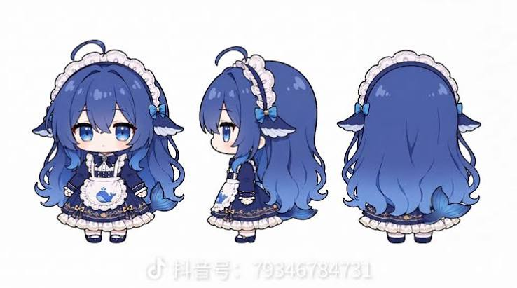

# 用户原始提示词与参考图

以下按提出顺序收录直接影响游戏玩法、交付形式和角色造型的用户原话。附件使用仓库内的相对路径。

### 最初的游戏需求

> 在本地帮我做一个可以以第一人称视角游玩的小镇，小镇中间有一个喷泉，小镇里需要包含一条河流和一架桥，还有少量地标性建筑，可以进入参观。小镇里还要藏十碗大白饭，收集齐之后可以在中央喷泉处召唤大肥鱼。画面和建模细节做的越高越好，要能对标3A大作的级别，你可以慢慢打磨，不限时间和token消耗。你可以上网搜索素材，但是不能直接使用素材，可以使用three.js，最终交一个可以直接运行的html文件。

### 明确角色身份

> 大肥鱼是deepseek二创形象不要搞错了

### 用三视图校准脸型和全身造型

> 大肥鱼现在的建模不过关，至少要做的脸型要对吧。你看到还有问题就继续打磨。然后我还是给你个参考图，按这个来建模。

### 确定镇名

> 然后你把这个小镇的名字叫白饭小镇吧

### 确定笑容与双手捧饭的姿势

> 哦对，大肥鱼的表情可以用这个。以及之前手里捧着的白饭还是要的。

### 交付后的使用问题

> 现在这个是脱离了工作环境也能单独运行吧，然后还有是不是现在没法清除进度

使用方法和清除进度入口见 [README](../README.md)。
